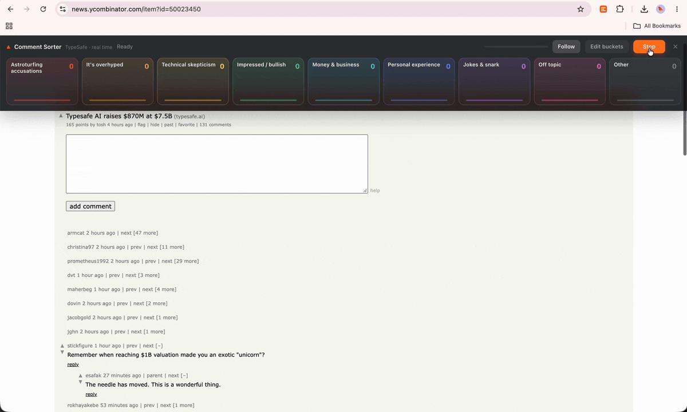
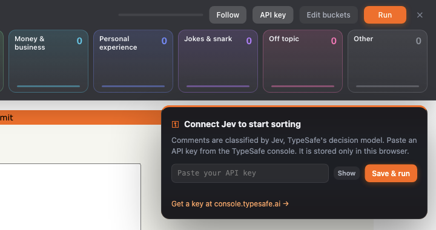

# HN Jev Sorter

A Chrome extension that sorts Hacker News comments into buckets while you watch. Pick the buckets ("accuses others of astroturfing", "it's overhyped", "off topic", or your own), press Run, and each comment flies into the bucket it belongs in. Hover a bucket to read everything in it.

Comments are classified by [Jev](https://docs.typesafe.ai/), TypeSafe's decision model. Jev answers each one in about 300 ms, so the comments sort in real time.



## Install

1. Download this repository: **Code → Download ZIP**, then unzip it. Or clone it:

   ```bash
   git clone https://github.com/ritza-co/hn-jev-sorter.git
   ```

2. Open `chrome://extensions` and turn on **Developer mode** (top right).
3. Click **Load unpacked** and select the `hn-jev-sorter` folder.
4. Pin the extension: open the puzzle-piece menu in the toolbar and click the pin next to **HN Jev Sorter**.

This works in Chrome and other Chromium browsers, such as Edge, Brave, and Arc.

## Add your API key

You need a Jev API key from the [TypeSafe console](https://console.typesafe.ai/keys).

A setup page opens when you install the extension. Paste your key there and click **Save**. The extension makes one small request to check the key and then stores it in Chrome's local extension storage. The key is only ever sent to `api.typesafe.ai`.

If you skip that step, the sorter asks for the key the first time you open it on a thread:



To change or remove the key later, click **API key** in the sorter bar. You can also reopen the setup page from `chrome://extensions` → **HN Jev Sorter** → **Details** → **Extension options**.

## Use it

1. Open any Hacker News comment page, for example the [front page](https://news.ycombinator.com/) → **comments**.
2. Click the extension icon. The bucket bar slides in at the top of the page. Click the icon again to hide it.
3. Press **Run**.

During a run:

- Comments are sent to their buckets in thread order. Each one gets a coloured label on the page showing its bucket and Jev's probability, such as `It's overhyped · 97%`.
- **Follow** scrolls the page along with the sort. If you scroll the page yourself, Follow turns off.
- **Stop** cancels the run.

When it finishes:

- Hover over a bucket to read its comments, sorted by Jev's probability. Click a bucket to keep the list open.
- Click a comment in the list to jump to it in the thread.

## Make your own buckets

Click **Edit buckets** to rename, rewrite, add, or remove buckets. You can have up to 12. Each bucket has a name and a description. Jev reads the description, so say what belongs in the bucket rather than relying on the name alone:

| Bucket | Description |
| --- | --- |
| Astroturfing accusations | Accuses the company, other commenters, or the votes of being shills, bots, paid marketing, or astroturfing |
| It's overhyped | Says it is hype, a bubble, overvalued, or will not live up to the claims |
| Off topic | A tangent unrelated to the story or to the comment it replies to |

An **Other** bucket is always included, so Jev never has to force a comment into a bucket that doesn't fit. **Reset to suggestions** restores the default buckets. Your buckets are saved in the browser.

## How it works

The extension asks Jev one [Choice](https://docs.typesafe.ai/primitives/choice) question per comment. The buckets are the options:

```json
{
  "model": "jev-latest",
  "state": "Hacker News thread: \"Typesafe AI raises $870M at $7.5B\" (typesafe.ai).",
  "questions": {
    "bucket": {
      "type": "choice",
      "instructions": {
        "question": "Which category best describes what this Hacker News comment is doing?",
        "replying_to": "<parent comment, if any>",
        "comment": "<the comment>"
      },
      "criteria": {
        "astroturfing_accusations": "Accuses the company, other commenters, or the votes of being shills, bots, paid marketing, or astroturfing",
        "it_s_overhyped": "Says it is hype, a bubble, overvalued, or will not live up to the claims",
        "other": "None of the other categories fit"
      }
    }
  }
}
```

Jev returns the chosen bucket and a probability for every bucket. The extension sends six requests at a time from its background service worker, and the animations play as the answers arrive.

| File | What it does |
| --- | --- |
| `content.js` | The bucket bar, flight animations, bucket lists, and bucket editor. Runs in a shadow root so Hacker News styles don't affect it. |
| `background.js` | Calls the TypeSafe API and checks the key. |
| `options.html`, `options.js` | The setup page. |

There is no build step. Edit a file and click reload on `chrome://extensions`.

### Cost

Each comment takes one request of roughly 800 tokens. A 140-comment thread uses about 115,000 tokens. The sorter bar shows the running token count.

### Privacy

Comment text, the parent comment, and the thread title are sent to the TypeSafe API. Nothing else leaves your browser, and the only site the extension runs on is `news.ycombinator.com`.

---

<sub>Built by [Ritza](https://ritza.co). We make demos, tutorials, and docs that show off technical products. If you'd like something like this for yours, [get in touch](https://ritza.co).</sub>

## License

[MIT](LICENSE)
